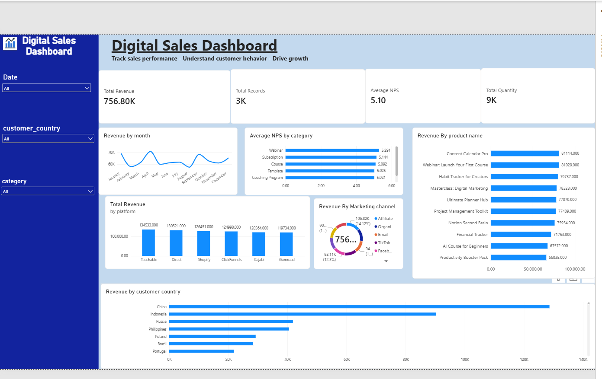
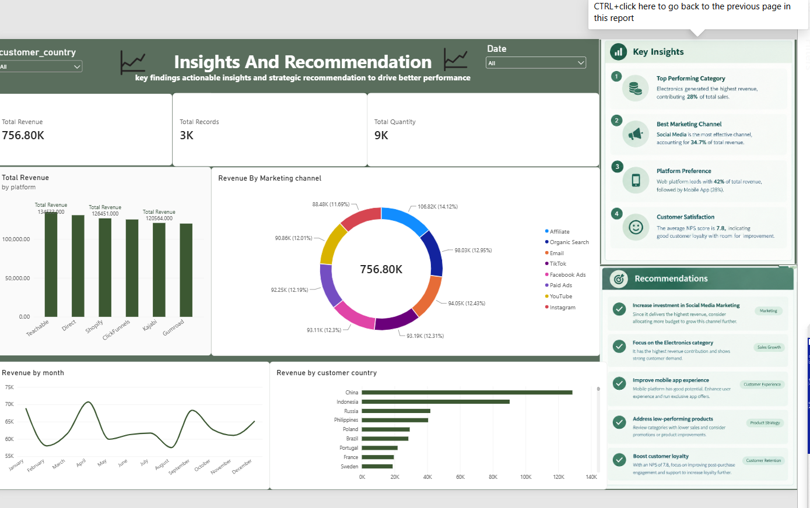

# Sales, Marketing Coupon & Customer Analytics

A comprehensive **Power BI** project designed to analyze sales performance, customer purchasing behavior, and marketing coupon effectiveness to drive data-driven business decisions.

---

## 📌 Project Overview

This project provides an end-to-end business intelligence solution for evaluating sales trends, customer behavior, and marketing ROI. Using interactive dashboards, advanced data modeling, and DAX calculations, it transforms raw data into actionable insights for marketing and sales strategy optimization.

---

## 🛠️ Key Features & Technical Highlights

* **Data Transformation & Cleaning:** Handled using **Power Query** to ensure data accuracy and consistency.
* **Data Modeling:** Built structured relational data models (Star Schema) for seamless analytics.
* **Calculated Metrics:** Utilized **DAX (Data Analysis Expressions)** to build custom Key Performance Indicators (KPIs) and measures.
* **Interactive Dashboards:** Created visual dashboards to track performance metrics, customer demographics, and promotional impact.

---

## 📊 Key Insights & Analytics Focus

1. **Sales Performance:** Tracking revenue growth, top-performing product categories, and regional sales distribution.
2. **Customer Analytics:** Understanding customer purchase patterns, repeat behavior, and segmentation.
3. **Coupon Effectiveness:** Analyzing coupon usage rates, discount impact, and total revenue generated per promotion campaign.

---

## 📸 Dashboards Preview

### Dashboard Overview - Page 1


### Dashboard Overview - Page 2


---

## 📂 Project Structure

```text
├── dashboard1.png                # Screenshot of Dashboard Page 1
├── dashboard2.png                # Screenshot of Dashboard Page 2
├── power bi project new oneeee.pbix # Power BI Desktop File
└── README.md                     # Project documentation
